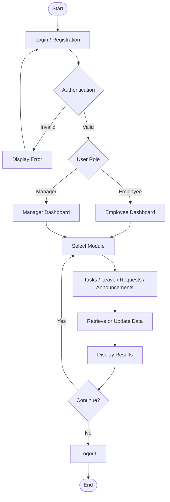

<div align="center">

# Hi, I'm Soundarya 👋

### Computer Science Engineering Student | Software Development

**Learning · Building · Improving 🚀**

</div>

---

## About Me

```yaml
Name: Soundarya
Role: Computer Science Engineering Student
Interests:
  - Software Development
  - Android Application Development
Currently Learning:
  - MERN Stack
  - Git and GitHub
  - Advanced SQL
  - Advanced Java
Goal: Build useful, real-world technology solutions
```

---

## Featured Project

### 📱 OfficeFlow — Employee Work Companion

An Android mobile application designed to bring everyday office activities into one centralized platform for employees and managers.

**Key Modules**
- Authentication and user registration
- Task management
- Leave management
- Internal requests
- Office announcements

### Application Architecture & Flow



### Technical Highlights

- **Frontend:** Java, Android SDK, XML
- **Development Environment:** Android Studio
- **Build System:** Gradle with Kotlin DSL
- **Backend / Database:** Firebase, where configured

🔗 [Explore OfficeFlow Repository](https://github.com/soundarya820/OfficeFlow)

---

## Tech Stack & Tooling

<div align="center">

### Programming Languages


### Development Tools & Databases


</div>

---

## Other Projects

| Project | Domain / Focus | Technologies | Description |
|---|---|---|---|
| OfficeFlow | Android Development | Java, Android, XML | An employee work companion app for organizing daily tasks, leave requests, and office communication. |
| Parent–Teacher Portal | Web Development | HTML, CSS, JavaScript, PHP | A web-based portal designed to improve communication between parents and teachers, share student updates, and make academic information easier to access. |

---

## Career Goal

My goal is to become a skilled software developer who builds reliable, user-friendly applications and solves real-world problems through technology. I am focused on strengthening my programming fundamentals, developing full-stack web applications using the MERN stack, improving my SQL and Java skills, and gaining practical experience through projects. I believe in continuous learning, clean code, teamwork, and building solutions that make everyday tasks easier.

---

## Connect With Me

<div align="center">

[](YOUR_LINKEDIN_URL)
[](mailto:YOUR_EMAIL_ADDRESS)
[](https://github.com/soundarya820)
[](YOUR_LEETCODE_URL)

</div>

<div align="center">

*Learning, building, and improving one project at a time. ✨*

</div>
