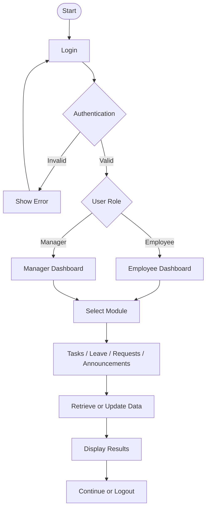

<div align="center">

# Hi, I'm Soundarya 👋

### Computer Science Engineering Student | Data Analytics | Software Development

**Learning · Building · Improving 🚀**

</div>

---

## About Me

```yaml
Name: Soundarya
Role: Computer Science Engineering Student
Interests:
  - Data Analytics and Business Intelligence
  - Software Development
  - Android Application Development
Currently Learning:
  - Advanced SQL and Python
  - Power BI and Data Visualization
  - Git and GitHub
Goal: Build useful, real-world technology solutions
```

---

## Featured Project

### 📱 OfficeFlow — Employee Work Companion

An Android mobile application designed to bring everyday office activities into one centralized platform, with dedicated experiences for employees and managers.

**Key Modules**
- Authentication and user registration
- Task management
- Leave management
- Internal requests
- Office announcements

**Application Architecture & Flow**



**Technical Highlights**
- **Frontend:** Android, Java, XML layouts
- **Build System:** Gradle with Kotlin DSL
- **Backend / Database:** Firebase, where configured
- **IDE:** Android Studio

🔗 **[View OfficeFlow Repository](https://github.com/soundarya820/OfficeFlow)**

---

## Tech Stack & Tooling

<div align="center">

### Programming Languages


### Data Engineering & Analytics


### Development Tools


</div>

---

## Other Projects

| Project | Domain / Focus | Technologies | Description |
|---|---|---|---|
| OfficeFlow | Android Development | Java, Android, XML | Employee work companion application |
| Forensiq | Cybersecurity | Python, Knowledge Graphs, Blockchain | Tender-risk analysis and audit project |
| Neara AI | Artificial Intelligence | Verify against project repository | AI-powered hackathon project |
| Data Analytics Projects | Data Analytics | Python, SQL, Power BI | Data exploration, analysis, and visualization |

*Project descriptions and technology stacks should be updated to match each project's actual implementation.*

---

## Currently Learning & Upskilling

- [ ] Advanced SQL and query optimization
- [ ] Power BI dashboards and DAX
- [ ] Python for data analysis
- [ ] Git and GitHub workflows
- [ ] Android application development

---

## Career Goal

> My goal is to combine analytical thinking and software development skills to build practical, data-driven solutions that solve real-world problems. I believe in continuous learning, hands-on projects, and improving through experimentation.

---

## Connect With Me

<div align="center">

[](https://github.com/soundarya820)

</div>

<div align="center">

*Learning, building, and improving one project at a time. ✨*

</div>
